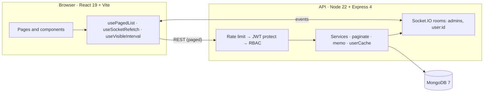

<div align="center">


# ADVIDUS Enterprise Platform

**Role-based task management built for 60,000 employees and 50,000+ tasks.**
Admins govern everything, employees work their own board, and nothing in the API ever returns an unbounded list.


[Live app](https://avidus-frontend.onrender.com) · [Developer handover](docs/HANDOVER.md) · [OpenAPI spec](openapi.yml)

</div>

---

## Contents

1. [Features](#features)
2. [Architecture](#architecture)
3. [Built for scale](#built-for-scale)
4. [Quick start](#quick-start)
5. [Access control (RBAC)](#access-control-rbac)
6. [API](#api)
7. [Realtime](#realtime)
8. [Frontend and design system](#frontend-and-design-system)
9. [Project structure](#project-structure)
10. [Configuration](#configuration)
11. [Deployment](#deployment)
12. [Testing and quality gates](#testing-and-quality-gates)
13. [Known limits](#known-limits)

---

## Features

| Area | What you get |
|---|---|
| **RBAC** | `admin` and `user` roles, JWT auth, permission middleware (`protect`, `adminOnly`, `checkPermission`), instant logout on deactivation |
| **Tasks** | Drag-and-drop Kanban, assign to a person or an AI agent, comments, templates, assignee can update status |
| **Governance** | Multi-level approval chains, immutable activity log with action filter, task monitor for admins |
| **Organisation** | Departments tree, designations, org chart, per-department headcount |
| **Insight** | Admin dashboard, top-N analytics, performance leaderboard, notifications bell |
| **Realtime** | Socket.IO events scoped to admins and the users they concern |
| **Operations** | Docker Compose, GitHub Actions CI, Render blueprint, structured Winston logs |

## Architecture



Controllers stay thin, business rules live in `services/`, every list goes through one pagination helper, and every realtime event is emitted to rooms, never broadcast.

## Built for scale

Managers browse the whole organisation, so the system is designed around bounded work per request:

- **Server-side paging, search and filters** on users, tasks and logs (`page`, `limit`, `q`, `status`, `role`, `action`). The UI never holds the full dataset.
- **Bounded analytics:** top-N owners, grouped aggregates memoized for 5 s, `$limit` before `$lookup`.
- **Cached auth:** one DB read per user per 5 s, invalidated instantly when an account is deactivated or deleted.
- **Room-scoped realtime:** a task update reaches its owner, assignee and admins, not 60,000 sockets.
- **Safe search:** query values are type-checked and regex-escaped; employees can only search names.
- **Deploy-time indexes:** `autoIndex` is off in production, `npm run indexes` builds what is missing.
- **Visibility-aware refresh:** socket events trigger a coalesced refetch; a 60 s fallback pauses on hidden tabs.

Rehearse it on your own database (never production):

```bash
cd backend
npm run seed:bulk -- --yes        # 60,000 users + 50,000 tasks, then prints hot-query timings
```

Design rules, trade-offs and limits are written up in [docs/HANDOVER.md](docs/HANDOVER.md).

## Quick start

**Docker**

```bash
docker compose up --build -d
docker compose exec backend npm run seed
```

**Local**

```bash
# Terminal 1 · API on :5050
cd backend && cp .env.example .env     # set MONGO_URI and JWT_SECRET
npm install && npm run seed && npm run dev

# Terminal 2 · UI on :5180
cd frontend && npm install && npm run dev
```

| Service | URL |
|---|---|
| Frontend | http://localhost:5180 |
| Backend API | http://localhost:5050/api |
| MongoDB | localhost:27017 |

**Demo accounts** (created by `npm run seed`)

| Role | Email | Password |
|---|---|---|
| Admin | `admin@example.com` | `Admin@123` |
| Employee | 100 seeded employees; the login page lists a few | `User@123` |

Bulk-seeded accounts (`seed:bulk`) are `u<N>@seed.local` with password `Seed@12345`.

## Access control (RBAC)

| Capability | Admin | Employee |
|---|:---:|:---:|
| Own and assigned tasks: list, create, edit | yes | yes |
| Task assigned by someone else | yes | **status only** |
| Delete task | yes | no (`tasks:delete` is admin-only) |
| User directory | full rows, filters, search by name or email | active users, name and designation only |
| Activity log | all entries | own entries |
| Admin tasks, metrics, analytics, dashboard | yes | no |
| Activate, deactivate, delete users | yes (not yourself) | no |
| Performance of another user | any | own only |
| AI agents | read and write | read (active only) |

Middleware chain: `protect` (verify JWT, load `{role,status}`) → `adminOnly` or `checkPermission('scope:action')`. The permission map lives in `backend/src/utils/permissions.ts`.

## API

Envelope: `{ "success": true, ...fields, "serverTime": "…" }`. Paged lists return `{ items, page, limit, total, totalPages }`.

<details open>
<summary><b>Auth</b></summary>

| Method | Endpoint | Access |
|---|---|---|
| POST | `/api/auth/register` | Public |
| POST | `/api/auth/login` | Public (only failed attempts count toward the limit) |
| GET | `/api/auth/me` | Authenticated |
| POST | `/api/auth/ensure-demo`, GET `/api/auth/credentials` | Public, disabled when `DEMO_MODE=false` |
</details>

<details open>
<summary><b>Tasks</b></summary>

| Method | Endpoint | Access |
|---|---|---|
| GET | `/api/tasks?limit&status&page` | Tasks I own or am assigned (array, default 200, max 500) |
| POST | `/api/tasks` | Authenticated |
| GET | `/api/tasks/summary` | Status counts for my tasks |
| PUT | `/api/tasks/:id` | Owner or admin; assignee: status only |
| DELETE | `/api/tasks/:id` | Admin |
| GET / POST / DELETE | `/api/tasks/:taskId/comments` | Authenticated |
| POST | `/api/tasks/simulate` | Admin, only when `ENABLE_SIMULATION=true` |
</details>

<details open>
<summary><b>Admin</b></summary>

| Method | Endpoint | Access |
|---|---|---|
| GET | `/api/admin/dashboard` | Admin, first page of each list in one call |
| GET | `/api/admin/users?page&limit&q&role&status` | Admin: full rows. Employee: names only |
| PATCH | `/api/admin/users/:id/status` | Admin |
| DELETE | `/api/admin/users/:id` | Admin, also removes their tasks |
| GET | `/api/admin/logs?page&limit&action` | Admin: all. Employee: own |
| GET | `/api/admin/tasks?page&limit&status&q` | Admin |
| GET | `/api/admin/metrics` | Admin |
| GET | `/api/admin/analytics?top=20` | Admin, top-N owners (max 100) |
| GET | `/api/analytics` | Authenticated, public task counts |
</details>

<details>
<summary><b>Organisation, performance, approvals, agents, notifications, templates, settings</b></summary>

| Method | Endpoint | Access |
|---|---|---|
| GET | `/api/org/departments`, `/departments/tree`, `/designations` | Authenticated |
| GET | `/api/org/chart` | Authenticated, 500-user sample + per-department counts |
| GET | `/api/org/my-department` | Authenticated, headcount of my own department |
| POST / PUT / DELETE | `/api/org/departments`, `/api/org/designations` | Admin |
| GET | `/api/performance/me` | Authenticated |
| GET | `/api/performance/user/:userId` | Admin, or own id |
| GET | `/api/performance/all?limit=50` | Admin, leaderboard (max 200) |
| POST | `/api/performance/snapshot` | Admin |
| GET | `/api/approvals/my`, `/api/approvals/task/:taskId` | Authenticated |
| POST | `/api/approvals/task/:taskId` | Create chain (`tasks:write`) |
| POST | `/api/approvals/:approvalId/decide` | The assigned approver |
| GET / POST | `/api/agents` | Read: all. Write: admin |
| PATCH / DELETE | `/api/agents/:id` | Admin |
| GET | `/api/notifications`, `/unread-count` | Authenticated |
| PATCH / POST | `/api/notifications/:id/read`, `/read-all` | Authenticated |
| GET / POST / PUT / DELETE | `/api/templates` | Read: authenticated. Write: `tasks:write`, delete: admin |
| GET | `/api/settings`, `/api/settings/integrations` | Authenticated |
| PUT | `/api/settings/:key` | Admin |
</details>

## Realtime

Socket.IO at `/ws`, authenticated with the JWT. Each socket joins `user:<id>`; admins also join `admins`.
`emitEvent(event, payload, userIds[])` sends to `admins` plus those user rooms only.

Events: `task.created`, `task.updated`, `task.deleted`, `activity.created`, `user.status_changed`, `approval.created`, `approval.decided`, `comment.created`, `notification.new`, `notification.updated`, `agent.*` (admins only).
The client coalesces bursts into one refetch per 1.5 s, and logs out immediately on `user.status_changed` for its own account.

## Frontend and design system

React 19 · TypeScript · Vite 8 · Chart.js · lazy-loaded pages. State lives in hooks, not a global store.

**Data hooks:** `usePagedList` (server paging with abort and stale-response protection) · `useDebouncedValue` · `useSocketRefetch` · `useVisibleInterval` · `useLatestSignal`.

**CSS** is one documented file, [`frontend/src/index.css`](frontend/src/index.css), dark-first:

| Section | Contents |
|---|---|
| 1 Tokens | colour scale and semantic roles (WCAG AA checked), 4 px spacing, radii, shadows, z-index, type scale, motion |
| 2 Reset | box model, body, scrollbars |
| 3 Layout | glass shell, sidebar, topbar, content area, page grid |
| 4 Components | buttons, inputs, toolbar, cards, stats, tables, badges, modals and toasts, nav, Kanban, activity, skeleton, bell, charts, pager, auth page |
| 5 Utilities | small helpers |
| 6 Responsive | 640 / 900 / 1200 px; icon-rail sidebar under 900 px, bottom tab bar under 640 px |
| 7 Accessibility | focus rings, reduced motion |

Rules for contributors: use tokens instead of raw colours; add component styles only in section 4; transition named properties (never `all`); `backdrop-filter` only on the shell and overlays; no shadows on list rows.

## Project structure

```
.
├── backend/
│   ├── src/
│   │   ├── config/        env (typed), db (pool, autoIndex), logger
│   │   ├── controllers/   thin request handlers
│   │   ├── services/      business logic
│   │   ├── middleware/    auth, validator, rate limiter, error handler
│   │   ├── models/        12 Mongoose schemas and their indexes
│   │   ├── routes/        route tables
│   │   ├── utils/         paginate, memo, userCache, realtime, permissions
│   │   ├── seed.ts        demo data      seedBulk.ts  60k load data      syncIndexes.ts  deploy indexes
│   │   └── server.ts      app, Socket.IO rooms, graceful shutdown
│   └── tests/             mock-based Vitest suites
├── frontend/src/
│   ├── components/        activity · agents · common · dashboard · layout · tasks · users
│   ├── pages/             Auth, Dashboard, Analytics, Approvals, Organization, Performance, Settings, Templates, Integrations
│   ├── hooks/             data and realtime hooks
│   ├── contexts/          AuthContext (JWT, shared socket, session guard)
│   ├── services/api.ts    typed HTTP client
│   └── index.css          design system
├── docs/HANDOVER.md       knowledge transfer
├── docker-compose.yml  ·  render.yaml  ·  openapi.yml  ·  .github/workflows/ci.yml
```

## Configuration

Copy `backend/.env.example` to `backend/.env`.

| Variable | Default | Purpose |
|---|---|---|
| `MONGO_URI`, `JWT_SECRET` | required | database and token signing |
| `PORT`, `NODE_ENV`, `CORS_ORIGIN`, `JWT_EXPIRES_IN`, `LOG_LEVEL` | see example | basics |
| `TRUST_PROXY` | `0` | proxy hops in front of the API (`1` on Render or Nginx) |
| `API_RATE_MAX`, `AUTH_RATE_MAX` | `2000`, `50` | per-IP caps per 15 min |
| `DEMO_MODE` | `true` | `false` disables the public demo-credential endpoints |
| `AUTO_SEED` | `true` | `false` stops the small demo seed on an empty database |
| `ENABLE_SIMULATION` | `false` | demo-only random status flipper, never on real data |

Frontend: `VITE_API_URL` (defaults to `http://localhost:5050/api`).

## Deployment

`render.yaml` defines the API (`backend/`) and the static site (`frontend/`). The API start command builds missing indexes first, and the health check is `GET /`.
Before a real rollout set `DEMO_MODE=false`, `AUTO_SEED=false`, a strong `JWT_SECRET` and `TRUST_PROXY=1`.

## Testing and quality gates

```bash
cd backend  && npm run typecheck && npm test && npm run build    # 155 mock-based tests, no database needed
cd frontend && npm run typecheck && npm run lint && npm run build
```

CI (`.github/workflows/ci.yml`) runs the same gates on every push and pull request.

## Known limits

- Backend tests are mock-based; run `seed:bulk` against a real MongoDB to measure query timings.
- Login hashing uses pure-JS `bcryptjs`, the first thing to saturate when thousands sign in at once.
- Several API instances need the Socket.IO Redis adapter; the 5 s caches are per process.
- Render's free tier suits a demo, not 60,000 live sockets.

Full list with mitigations: [docs/HANDOVER.md](docs/HANDOVER.md#8-known-ceilings-be-honest-with-stakeholders).
